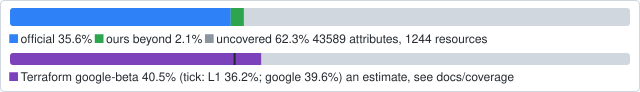
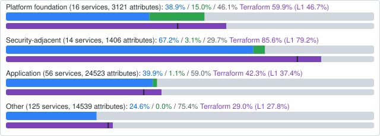
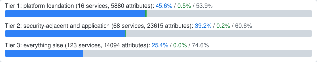
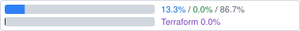
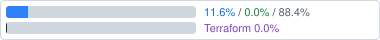
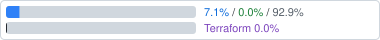
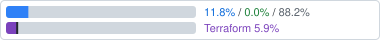

# config-connector-extensions

Kubernetes kinds for Google Cloud that
[Config Connector](https://github.com/GoogleCloudPlatform/k8s-config-connector)
(KCC) does not have yet, or has without a field a workload needs. Install
it beside Config Connector; it runs Config Connector's own reconciler for
a few extra kinds, in its own API groups, and retires each kind when
Config Connector ships it.

config-connector-extensions is not affiliated with or endorsed by Google.
"Config Connector" names the project it extends.

<!-- coverage:start -->
## Coverage

How much of Google Cloud's API can be managed as Kubernetes resources, counted in attributes (writable fields of a resource's create request) across 207 services and 1244 resources. **Official** is what Config Connector's CRDs at the pin (`UPSTREAM.md`) cover; **ours beyond official** is what only this repository's kinds cover; **uncovered** is in the API and in neither. The counts come from matching CRD fields to API fields by name, so they are estimates: see [docs/coverage](docs/coverage/README.md) for the method, its error and how to regenerate.



The purple bar under each blue and green one is **Terraform**: the share of the same attributes that a writable attribute of the `google-beta` provider matches (lenient rule, L2), with the strict rule (L1) as a dark tick; `google` differs by under a point and is a column in the tables. It is an estimate from the catalog repository's `docs/terraform/` at `13064af34996`, with the error described under "Method and error" in its `docs/terraform-leverage.md` ([source and pin](docs/coverage/README.md#terraform)).

Services do not matter equally, so the total misleads. Everything up through a managed Kubernetes cluster is table stakes for a platform team; security teams need what sits next to it; the rest is application primitives. Each service has a **category** and a **tier** ([`priority.csv`](docs/coverage/priority.csv), editable): **tier 1** is `platform-foundation` (organization, folders, projects, organization policy, IAM, tags, networking, DNS, KMS, log sinks, GKE and Fleet), **tier 2** is `security-adjacent` (Security Command Center, VPC Service Controls, Cloud Asset, Binary Authorization, Secret Manager, CA, Armor) and `application` (Pub/Sub, Storage, Run, SQL, BigQuery, ...), **tier 3** is the rest. The services counted are Google Cloud infrastructure APIs; 116 non-cloud APIs in Discovery (Workspace, Ads, Play, Maps, YouTube, ...) are left out ([how](docs/coverage/README.md#tiers-and-categories)).

By category, counted per resource (Compute Engine's VPC networking is foundation, its machines and load balancers are application):



By tier, counted per service:



<sub>Blue: official. Green: ours beyond official. Grey: uncovered. Each bar reads official / ours beyond / uncovered. Purple: Terraform `google-beta` (L2), the dark tick L1. Rollups: [`categories.csv`](docs/coverage/categories.csv), [`tiers.csv`](docs/coverage/tiers.csv); every service: [`services.csv`](docs/coverage/services.csv). What to build first for the foundation: [`foundation.md`](docs/coverage/foundation.md).</sub>

Tier 1, 16 services, most covered attributes first:

| Tier | Category | Service | Coverage | Official | Ours beyond | Uncovered | Terraform `google-beta` | Terraform `google` |
| ---: | --- | --- | --- | ---: | ---: | ---: | ---: | ---: |
| 1 | foundation | `compute.googleapis.com` |  | 50.6% | 1.2% | 48.2% | 56.0% | 53.2% |
| 1 | foundation | `container.googleapis.com` |  | 43.3% | 0.0% | 56.7% | 68.6% | 68.2% |
| 1 | foundation | `logging.googleapis.com` |  | 24.0% | 2.1% | 74.0% | 37.6% | 37.6% |
| 1 | foundation | `networkconnectivity.googleapis.com` |  | 60.1% | 0.0% | 39.9% | 74.5% | 73.2% |
| 1 | foundation | `orgpolicy.googleapis.com` |  | 67.8% | 0.0% | 32.2% | 92.6% | 92.6% |
| 1 | foundation | `dns.googleapis.com` |  | 29.5% | 0.0% | 70.5% | 33.3% | 32.6% |
| 1 | foundation | `iam.googleapis.com` |  | 39.8% | 8.0% | 52.2% | 78.8% | 78.8% |
| 1 | foundation | `gkehub.googleapis.com` |  | 16.5% | 0.0% | 83.5% | 54.0% | 54.0% |
| 1 | foundation | `billingbudgets.googleapis.com` |  | 85.7% | 0.0% | 14.3% | 78.6% | 78.6% |
| 1 | foundation | `cloudresourcemanager.googleapis.com` |  | 40.0% | 0.0% | 60.0% | 65.5% | 65.5% |
| 1 | foundation | `cloudkms.googleapis.com` |  | 42.9% | 0.0% | 57.1% | 52.4% | 50.0% |
| 1 | foundation | `cloudidentity.googleapis.com` |  | 21.3% | 0.0% | 78.7% | 31.9% | 21.3% |
| 1 | foundation | `vpcaccess.googleapis.com` |  | 100.0% | 0.0% | 0.0% | 100.0% | 100.0% |
| 1 | foundation | `essentialcontacts.googleapis.com` |  | 100.0% | 0.0% | 0.0% | 100.0% | 100.0% |
| 1 | foundation | `servicenetworking.googleapis.com` |  | 100.0% | 0.0% | 0.0% | 100.0% | 100.0% |
| 1 | foundation | `cloudbilling.googleapis.com` |  | 13.3% | 0.0% | 86.7% | 0.0% | 0.0% |

<details><summary>Tier 2: 68 services other modules use</summary>

| Tier | Category | Service | Coverage | Official | Ours beyond | Uncovered | Terraform `google-beta` | Terraform `google` |
| ---: | --- | --- | --- | ---: | ---: | ---: | ---: | ---: |
| 2 | application | `dlp.googleapis.com` |  | 57.5% | 0.0% | 42.5% | 83.7% | 83.7% |
| 2 | application | `dialogflow.googleapis.com` |  | 40.4% | 0.0% | 59.6% | 33.1% | 32.5% |
| 2 | application | `monitoring.googleapis.com` |  | 45.7% | 0.0% | 54.3% | 7.9% | 7.9% |
| 2 | application | `aiplatform.googleapis.com` |  | 16.6% | 0.0% | 83.4% | 10.0% | 9.8% |
| 2 | application | `dataproc.googleapis.com` |  | 47.5% | 0.0% | 52.5% | 70.5% | 70.0% |
| 2 | security | `networksecurity.googleapis.com` |  | 73.4% | 6.7% | 19.9% | 95.8% | 91.2% |
| 2 | application | `discoveryengine.googleapis.com` |  | 59.2% | 0.0% | 40.8% | 35.8% | 35.8% |
| 2 | application | `dataplex.googleapis.com` |  | 84.1% | 0.0% | 15.9% | 70.1% | 70.1% |
| 2 | application | `cloudbuild.googleapis.com` |  | 38.7% | 0.0% | 61.3% | 45.3% | 45.3% |
| 2 | application | `run.googleapis.com` |  | 38.1% | 3.3% | 58.6% | 71.0% | 69.6% |
| 2 | application | `networkservices.googleapis.com` |  | 54.2% | 0.0% | 45.8% | 75.3% | 74.7% |
| 2 | security | `privateca.googleapis.com` |  | 71.3% | 0.0% | 28.7% | 94.6% | 94.6% |
| 2 | application | `bigquery.googleapis.com` |  | 26.6% | 0.0% | 73.4% | 44.0% | 42.4% |
| 2 | application | `clouddeploy.googleapis.com` |  | 56.7% | 0.0% | 43.3% | 90.8% | 90.8% |
| 2 | application | `notebooks.googleapis.com` |  | 91.7% | 0.0% | 8.3% | 30.1% | 30.1% |
| 2 | application | `sqladmin.googleapis.com` |  | 41.6% | 0.4% | 58.0% | 6.9% | 6.9% |
| 2 | application | `appengine.googleapis.com` |  | 60.4% | 0.0% | 39.6% | 71.6% | 69.2% |
| 2 | application | `gkebackup.googleapis.com` |  | 90.8% | 0.0% | 9.2% | 73.5% | 73.5% |
| 2 | application | `composer.googleapis.com` |  | 95.3% | 0.0% | 4.7% | 88.4% | 88.4% |
| 2 | application | `apigee.googleapis.com` |  | 16.9% | 0.0% | 83.1% | 42.7% | 42.7% |
| 2 | security | `securitycenter.googleapis.com` |  | 14.5% | 1.0% | 84.5% | 19.5% | 19.5% |
| 2 | application | `chronicle.googleapis.com` |  | 15.6% | 0.0% | 84.4% | 83.5% | 83.5% |
| 2 | application | `eventarc.googleapis.com` |  | 88.5% | 0.0% | 11.5% | 79.5% | 79.5% |
| 2 | security | `accesscontextmanager.googleapis.com` |  | 51.9% | 0.0% | 48.1% | 99.2% | 99.2% |
| 2 | application | `vmwareengine.googleapis.com` |  | 79.8% | 0.0% | 20.2% | 65.5% | 65.5% |
| 2 | application | `tpu.googleapis.com` |  | 91.5% | 0.0% | 8.5% | 59.2% | 0.0% |
| 2 | application | `storage.googleapis.com` |  | 27.7% | 4.0% | 68.3% | 47.0% | 47.0% |
| 2 | application | `alloydb.googleapis.com` |  | 56.2% | 0.0% | 43.8% | 68.8% | 62.5% |
| 2 | application | `redis.googleapis.com` |  | 72.0% | 0.0% | 28.0% | 78.0% | 78.0% |
| 2 | security | `securityposture.googleapis.com` |  | 93.7% | 0.0% | 6.3% | 87.3% | 87.3% |
| 2 | application | `artifactregistry.googleapis.com` |  | 68.3% | 14.3% | 17.5% | 84.1% | 84.1% |
| 2 | application | `dataform.googleapis.com` |  | 53.8% | 0.0% | 46.2% | 47.3% | 19.4% |
| 2 | application | `cloudfunctions.googleapis.com` |  | 80.3% | 0.0% | 19.7% | 86.9% | 86.9% |
| 2 | application | `workstations.googleapis.com` |  | 52.3% | 0.0% | 47.7% | 87.5% | 86.4% |
| 2 | application | `bigtableadmin.googleapis.com` |  | 30.4% | 0.0% | 69.6% | 15.6% | 15.6% |
| 2 | application | `pubsub.googleapis.com` |  | 36.9% | 0.0% | 63.1% | 90.1% | 90.1% |
| 2 | application | `spanner.googleapis.com` |  | 42.5% | 0.0% | 57.5% | 68.8% | 68.8% |
| 2 | security | `certificatemanager.googleapis.com` |  | 75.0% | 0.0% | 25.0% | 86.4% | 86.4% |
| 2 | application | `managedkafka.googleapis.com` |  | 54.5% | 0.0% | 45.5% | 50.9% | 50.9% |
| 2 | application | `analyticshub.googleapis.com` |  | 66.7% | 0.0% | 33.3% | 88.1% | 88.1% |
| 2 | application | `backupdr.googleapis.com` |  | 40.0% | 0.0% | 60.0% | 55.7% | 48.6% |
| 2 | security | `binaryauthorization.googleapis.com` |  | 75.7% | 0.0% | 24.3% | 18.9% | 18.9% |
| 2 | application | `cloudscheduler.googleapis.com` |  | 100.0% | 0.0% | 0.0% | 100.0% | 100.0% |
| 2 | application | `securesourcemanager.googleapis.com` |  | 58.3% | 0.0% | 41.7% | 25.0% | 25.0% |
| 2 | security | `cloudasset.googleapis.com` |  | 100.0% | 0.0% | 0.0% | 34.6% | 34.6% |
| 2 | security | `recaptchaenterprise.googleapis.com` |  | 25.7% | 0.0% | 74.3% | 18.8% | 18.8% |
| 2 | security | `securitycentermanagement.googleapis.com` |  | 100.0% | 0.0% | 0.0% | 86.4% | 86.4% |
| 2 | security | `secretmanager.googleapis.com` |  | 33.3% | 33.3% | 33.3% | 100.0% | 100.0% |
| 2 | application | `modelarmor.googleapis.com` |  | 65.5% | 0.0% | 34.5% | 89.7% | 89.7% |
| 2 | security | `websecurityscanner.googleapis.com` |  | 90.0% | 0.0% | 10.0% | 80.0% | 0.0% |
| 2 | application | `apigateway.googleapis.com` |  | 81.0% | 0.0% | 19.0% | 76.2% | 0.0% |
| 2 | application | `bigqueryreservation.googleapis.com` |  | 53.1% | 0.0% | 46.9% | 71.9% | 65.6% |
| 2 | application | `bigqueryconnection.googleapis.com` |  | 34.8% | 0.0% | 65.2% | 67.4% | 67.4% |
| 2 | application | `memcache.googleapis.com` |  | 76.2% | 0.0% | 23.8% | 81.0% | 81.0% |
| 2 | application | `firestore.googleapis.com` |  | 34.2% | 0.0% | 65.8% | 94.7% | 94.7% |
| 2 | application | `cloudtasks.googleapis.com` |  | 24.0% | 0.0% | 76.0% | 50.0% | 50.0% |
| 2 | application | `datafusion.googleapis.com` |  | 33.3% | 0.0% | 66.7% | 69.4% | 69.4% |
| 2 | application | `privilegedaccessmanager.googleapis.com` |  | 61.1% | 0.0% | 38.9% | 66.7% | 66.7% |
| 2 | application | `biglake.googleapis.com` |  | 100.0% | 0.0% | 0.0% | 100.0% | 100.0% |
| 2 | security | `assuredworkloads.googleapis.com` |  | 45.0% | 0.0% | 55.0% | 90.0% | 90.0% |
| 2 | application | `datacatalog.googleapis.com` |  | 100.0% | 0.0% | 0.0% | 75.0% | 75.0% |
| 2 | application | `servicedirectory.googleapis.com` |  | 77.8% | 0.0% | 22.2% | 44.4% | 44.4% |
| 2 | application | `workflows.googleapis.com` |  | 70.0% | 0.0% | 30.0% | 100.0% | 100.0% |
| 2 | application | `dataflow.googleapis.com` |  | 1.5% | 0.0% | 98.5% | 8.3% | 8.3% |
| 2 | application | `datastore.googleapis.com` |  | 100.0% | 0.0% | 0.0% | 0.0% | 0.0% |
| 2 | application | `cloudquotas.googleapis.com` |  | 0.0% | 0.0% | 100.0% | 88.9% | 88.9% |
| 2 | application | `looker.googleapis.com` |  | 0.0% | 0.0% | 100.0% | 77.2% | 77.2% |
| 2 | application | `servicemanagement.googleapis.com` |  | 0.0% | 0.0% | 100.0% | 0.4% | 0.4% |

</details>

<details><summary>Tier 3: 82 other services where something is covered</summary>

| Tier | Category | Service | Coverage | Official | Ours beyond | Uncovered | Terraform `google-beta` | Terraform `google` |
| ---: | --- | --- | --- | ---: | ---: | ---: | ---: | ---: |
| 3 | other | `transcoder.googleapis.com` |  | 99.7% | 0.0% | 0.3% | 34.4% | 34.4% |
| 3 | other | `apihub.googleapis.com` |  | 54.7% | 0.0% | 45.3% | 14.6% | 14.6% |
| 3 | other | `datamigration.googleapis.com` |  | 62.5% | 0.0% | 37.5% | 43.0% | 43.0% |
| 3 | other | `containeranalysis.googleapis.com` |  | 13.1% | 0.0% | 86.9% | 2.3% | 2.3% |
| 3 | other | `datastream.googleapis.com` |  | 38.6% | 0.0% | 61.4% | 61.4% | 58.6% |
| 3 | other | `osconfig.googleapis.com` |  | 33.6% | 0.0% | 66.4% | 98.2% | 98.2% |
| 3 | other | `ces.googleapis.com` |  | 22.4% | 0.0% | 77.6% | 71.8% | 71.8% |
| 3 | other | `oracledatabase.googleapis.com` |  | 24.1% | 0.0% | 75.9% | 90.9% | 90.9% |
| 3 | other | `visionai.googleapis.com` |  | 52.0% | 0.0% | 48.0% | 0.0% | 0.0% |
| 3 | other | `gkemulticloud.googleapis.com` |  | 57.3% | 0.0% | 42.7% | 81.1% | 76.8% |
| 3 | other | `warehouse-visionai.googleapis.com` |  | 100.0% | 0.0% | 0.0% | 0.0% | 0.0% |
| 3 | other | `livestream.googleapis.com` |  | 66.0% | 0.0% | 34.0% | 0.0% | 0.0% |
| 3 | other | `batch.googleapis.com` |  | 88.7% | 0.0% | 11.3% | 0.0% | 0.0% |
| 3 | other | `commerceproducer.googleapis.com` |  | 95.3% | 0.0% | 4.7% | 0.0% | 0.0% |
| 3 | other | `contactcenterinsights.googleapis.com` |  | 29.8% | 0.0% | 70.2% | 21.0% | 21.0% |
| 3 | other | `cloudsecuritycompliance.googleapis.com` |  | 94.3% | 0.0% | 5.7% | 0.0% | 0.0% |
| 3 | other | `hypercomputecluster.googleapis.com` |  | 98.4% | 0.0% | 1.6% | 98.4% | 98.4% |
| 3 | other | `retail.googleapis.com` |  | 54.4% | 0.0% | 45.6% | 0.0% | 0.0% |
| 3 | other | `netapp.googleapis.com` |  | 30.2% | 0.0% | 69.8% | 94.4% | 94.4% |
| 3 | other | `identitytoolkit.googleapis.com` |  | 57.8% | 0.0% | 42.2% | 51.1% | 51.1% |
| 3 | other | `vmmigration.googleapis.com` |  | 27.2% | 0.0% | 72.8% | 0.0% | 0.0% |
| 3 | other | `developerconnect.googleapis.com` |  | 68.1% | 0.0% | 31.9% | 88.9% | 88.9% |
| 3 | other | `gsuiteaddons.googleapis.com` |  | 98.0% | 0.0% | 2.0% | 0.0% | 0.0% |
| 3 | other | `saasservicemgmt.googleapis.com` |  | 52.2% | 0.0% | 47.8% | 73.9% | 0.0% |
| 3 | other | `storagetransfer.googleapis.com` |  | 40.0% | 0.0% | 60.0% | 85.0% | 85.0% |
| 3 | other | `contentwarehouse.googleapis.com` |  | 8.4% | 0.0% | 91.6% | 0.0% | 0.0% |
| 3 | other | `datalabeling.googleapis.com` |  | 67.1% | 0.0% | 32.9% | 0.0% | 0.0% |
| 3 | other | `cloudchannel.googleapis.com` |  | 52.9% | 0.0% | 47.1% | 0.0% | 0.0% |
| 3 | other | `networkmanagement.googleapis.com` |  | 55.3% | 0.0% | 44.7% | 80.3% | 80.3% |
| 3 | other | `apphub.googleapis.com` |  | 100.0% | 0.0% | 0.0% | 89.5% | 89.5% |
| 3 | other | `connectors.googleapis.com` |  | 8.2% | 0.0% | 91.8% | 36.2% | 36.2% |
| 3 | other | `edgenetwork.googleapis.com` |  | 95.0% | 0.0% | 5.0% | 37.5% | 37.5% |
| 3 | other | `telcoautomation.googleapis.com` |  | 90.2% | 0.0% | 9.8% | 0.0% | 0.0% |
| 3 | other | `edgecontainer.googleapis.com` |  | 77.8% | 0.0% | 22.2% | 84.4% | 84.4% |
| 3 | other | `bigquerydatatransfer.googleapis.com` |  | 73.9% | 0.0% | 26.1% | 60.9% | 60.9% |
| 3 | other | `memorystore.googleapis.com` |  | 60.0% | 0.0% | 40.0% | 56.4% | 56.4% |
| 3 | other | `healthcare.googleapis.com` |  | 19.1% | 0.0% | 80.9% | 29.0% | 25.9% |
| 3 | other | `migrationcenter.googleapis.com` |  | 59.6% | 0.0% | 40.4% | 94.2% | 94.2% |
| 3 | other | `storageinsights.googleapis.com` |  | 96.8% | 0.0% | 3.2% | 74.2% | 74.2% |
| 3 | other | `financialservices.googleapis.com` |  | 84.8% | 0.0% | 15.2% | 0.0% | 0.0% |
| 3 | other | `cloudiot.googleapis.com` |  | 59.1% | 0.0% | 40.9% | 0.0% | 0.0% |
| 3 | other | `metastore.googleapis.com` |  | 56.5% | 0.0% | 43.5% | 78.3% | 78.3% |
| 3 | other | `translate.googleapis.com` |  | 100.0% | 0.0% | 0.0% | 0.0% | 0.0% |
| 3 | other | `translation.googleapis.com` |  | 100.0% | 0.0% | 0.0% | 0.0% | 0.0% |
| 3 | other | `videostitcher.googleapis.com` |  | 56.1% | 0.0% | 43.9% | 0.0% | 0.0% |
| 3 | other | `config.googleapis.com` |  | 52.5% | 0.0% | 47.5% | 35.0% | 35.0% |
| 3 | other | `configdelivery.googleapis.com` |  | 80.8% | 0.0% | 19.2% | 0.0% | 0.0% |
| 3 | other | `vectorsearch.googleapis.com` |  | 71.4% | 0.0% | 28.6% | 89.3% | 89.3% |
| 3 | other | `file.googleapis.com` |  | 41.5% | 0.0% | 58.5% | 90.2% | 90.2% |
| 3 | other | `vision.googleapis.com` |  | 100.0% | 0.0% | 0.0% | 0.0% | 0.0% |
| 3 | other | `jobs.googleapis.com` |  | 20.6% | 0.0% | 79.4% | 0.0% | 0.0% |
| 3 | other | `workloadmanager.googleapis.com` |  | 11.6% | 0.0% | 88.4% | 0.0% | 0.0% |
| 3 | other | `blockchainnodeengine.googleapis.com` |  | 92.3% | 0.0% | 7.7% | 84.6% | 84.6% |
| 3 | other | `pubsublite.googleapis.com` |  | 75.0% | 0.0% | 25.0% | 75.0% | 75.0% |
| 3 | other | `apikeys.googleapis.com` |  | 81.8% | 0.0% | 18.2% | 90.9% | 90.9% |
| 3 | other | `automl.googleapis.com` |  | 31.0% | 0.0% | 69.0% | 0.0% | 0.0% |
| 3 | other | `firebase.googleapis.com` |  | 47.4% | 0.0% | 52.6% | 63.2% | 0.0% |
| 3 | other | `parallelstore.googleapis.com` |  | 100.0% | 0.0% | 0.0% | 88.9% | 88.9% |
| 3 | other | `agentregistry.googleapis.com` |  | 24.2% | 0.0% | 75.8% | 48.5% | 48.5% |
| 3 | other | `rapidmigrationassessment.googleapis.com` |  | 72.7% | 0.0% | 27.3% | 0.0% | 0.0% |
| 3 | other | `cloudnumberregistry.googleapis.com` |  | 26.9% | 0.0% | 73.1% | 0.0% | 0.0% |
| 3 | other | `devicestreaming.googleapis.com` |  | 77.8% | 0.0% | 22.2% | 0.0% | 0.0% |
| 3 | other | `licensemanager.googleapis.com` |  | 100.0% | 0.0% | 0.0% | 28.6% | 28.6% |
| 3 | other | `testing.googleapis.com` |  | 7.1% | 0.0% | 92.9% | 0.0% | 0.0% |
| 3 | other | `appoptimize.googleapis.com` |  | 100.0% | 0.0% | 0.0% | 0.0% | 0.0% |
| 3 | other | `bigquerymigration.googleapis.com` |  | 15.0% | 0.0% | 85.0% | 0.0% | 0.0% |
| 3 | other | `iap.googleapis.com` |  | 100.0% | 0.0% | 0.0% | 33.3% | 33.3% |
| 3 | other | `parametermanager.googleapis.com` |  | 40.0% | 0.0% | 60.0% | 53.3% | 40.0% |
| 3 | other | `datalineage.googleapis.com` |  | 26.3% | 0.0% | 73.7% | 0.0% | 0.0% |
| 3 | other | `deploymentmanager.googleapis.com` |  | 62.5% | 0.0% | 37.5% | 100.0% | 100.0% |
| 3 | other | `ml.googleapis.com` |  | 2.9% | 0.0% | 97.1% | 0.0% | 0.0% |
| 3 | other | `bigquerydatapolicy.googleapis.com` |  | 44.4% | 0.0% | 55.6% | 77.8% | 77.8% |
| 3 | other | `ids.googleapis.com` |  | 66.7% | 0.0% | 33.3% | 66.7% | 66.7% |
| 3 | other | `speech.googleapis.com` |  | 44.4% | 0.0% | 55.6% | 0.0% | 0.0% |
| 3 | other | `documentai.googleapis.com` |  | 11.1% | 0.0% | 88.9% | 85.2% | 85.2% |
| 3 | other | `geminidataanalytics.googleapis.com` |  | 0.7% | 0.0% | 99.3% | 78.0% | 78.0% |
| 3 | other | `workflowexecutions.googleapis.com` |  | 60.0% | 0.0% | 40.0% | 0.0% | 0.0% |
| 3 | other | `cloudcontrolspartner.googleapis.com` |  | 100.0% | 0.0% | 0.0% | 0.0% | 0.0% |
| 3 | other | `cloudsupport.googleapis.com` |  | 11.8% | 0.0% | 88.2% | 5.9% | 5.9% |
| 3 | other | `firebasedatabase.googleapis.com` |  | 100.0% | 0.0% | 0.0% | 50.0% | 0.0% |
| 3 | other | `oslogin.googleapis.com` |  | 100.0% | 0.0% | 0.0% | 100.0% | 100.0% |
| 3 | other | `firebasestorage.googleapis.com` |  | 33.3% | 0.0% | 66.7% | 33.3% | 0.0% |

</details>
<!-- coverage:end -->

The kinds:

| Kind | Gap it fills | Source |
| --- | --- | --- |
| `sql.gcp.hfl.dev/v1beta1` `SQLUser` | `spec.databaseRoles`: Config Connector's `SQLUser` cannot grant a Cloud SQL user its database roles (`User.databaseRoles`, Terraform's `google_sql_user.database_roles`) | ours, on upstream's `SQLSSLCert` controller; upstream PR #7148 is watched |
| `sqladmin.gcp.hfl.dev/v1alpha1` `SQLAdminBackup` | an on-demand Cloud SQL backup (`backupRuns`); upstream master has the types but no controller | upstream PR #12553 |
| `secretmanager.gcp.hfl.dev/v1beta1` `SecretManagerSecret`, `SecretManagerSecretVersion` | `spec.location`: a regional secret (Terraform's `google_secret_manager_regional_secret`), in no Config Connector release or on master | master's direct controllers plus upstream PR #6651 |
| `artifactregistry.gcp.hfl.dev/v1beta1` `ArtifactRegistryRepository` | `remoteRepositoryConfig.<format>Repository.customRepository.uri`: a remote repository that pulls through an upstream of your choosing (Docker, Maven, npm, Python), not only the public ones Artifact Registry names, with `upstreamCredentials` (username and Secret Manager password version) for one that needs a login; in no Config Connector release or on master | master's direct controller plus upstream PR #13517; `upstreamCredentials` written here |
| `iam.gcp.hfl.dev/v1alpha1` `IAMWorkloadIdentityPoolNamespace` | a namespace in a workload identity pool (managed workload identities, Terraform's `google_iam_workload_identity_pool_namespace`); Config Connector has types for it only in a pull request, and no controller | upstream PR #14209's types; controller and the pool reference written here |
| `iam.gcp.hfl.dev/v1alpha1` `IAMWorkloadIdentityPoolManagedIdentity` | a managed identity in a pool namespace, with the attestation rules that say which workloads may receive it (Terraform's `google_iam_workload_identity_pool_managed_identity`); types only in a Config Connector pull request, no controller | upstream PR #14418's types; controller, the namespace reference and `attestationRules` written here |
| `run.gcp.hfl.dev/v1alpha1` `RunService` | a Cloud Run service with `invokerIamDisabled` (public without IAM, where an organization policy refuses `allUsers`) and GPUs (`template.nodeSelector`, `gpuZonalRedundancyDisabled`), which Config Connector's Terraform-based `RunService` cannot express; a narrow direct kind that owns the whole service | Config Connector's direct `RunWorkerPool`, for a service; the service fields written here |
| `iam.gcp.hfl.dev/v1alpha1` `IAMWorkloadIdentityPoolProviderKey` | a key for a workload identity pool provider, whose public half (in status) encrypts the provider's SAML assertions; in no Config Connector code, pull request or Terraform resource | written here from the IAM v1 API |
| `storage.gcp.hfl.dev/v1alpha1` `StorageBucketObject` | a small object in a bucket (a configuration file, a script), its content inline or from a Secret or ConfigMap; in no Config Connector code or pull request | written here from the Cloud Storage JSON API |
| `compute.gcp.hfl.dev/v1alpha1` `ComputeRouterRoutePolicy` | a Cloud Router route policy (import or export terms, as CEL), as HA VPN and interconnect setups use; in no Config Connector code or pull request | written here from the Compute Engine API |
| `compute.gcp.hfl.dev/v1alpha1` `ComputeRegionNetworkEndpoint` | an endpoint (internet address, domain name or VM port) in a regional network endpoint group, such as a regional load balancer's backend; Config Connector has zonal and global endpoints only | written here after Config Connector's zonal `ComputeNetworkEndpoint` |
| `compute.gcp.hfl.dev/v1alpha1` `ComputeRegionNetworkFirewallPolicy` | a regional network firewall policy, for firewall rules that apply to a VPC in one region; Config Connector has only the global policy | Config Connector's opt-in direct `ComputeNetworkFirewallPolicy`, for a region |
| `compute.gcp.hfl.dev/v1alpha1` `ComputeRegionNetworkFirewallPolicyRule` | one rule of a regional network firewall policy, addressed by its priority (action, direction, match on ranges, protocols and ports, address groups, FQDNs, region codes, threat intelligence and secure tags, targets); Config Connector's `ComputeFirewallPolicyRule` is for organization and folder policies | written here from the Compute Engine API, with the match fields of `ComputeFirewallPolicyRule` |
| `compute.gcp.hfl.dev/v1alpha1` `ComputeRegionNetworkFirewallPolicyAssociation` | attaches a regional network firewall policy to a VPC network; Config Connector has no association for it | written here from the Compute Engine API |
| `networksecurity.gcp.hfl.dev/v1alpha1` `NetworkSecurityAddressGroup` | an address group (IP ranges that firewall policy rules name as `srcAddressGroups` or `destAddressGroups`) owned by an organization, for its hierarchical firewall policies, or by a project (Terraform's `google_network_security_address_group`, whose `parent` is either); Config Connector's `NetworkSecurityAddressGroup` (alpha) takes a project only | Config Connector's direct `NetworkSecurityAddressGroup`, with an organization parent |
| `networksecurity.gcp.hfl.dev/v1alpha1` `NetworkSecuritySecurityProfile` | a security profile (threat prevention overrides, URL filters, or a mirroring or intercept endpoint group) owned by an organization, for its hierarchical firewall policies, or by a project (Terraform's `google_network_security_security_profile`, whose `parent` is either); Config Connector's `NetworkSecuritySecurityProfile` (alpha) takes a project only | Config Connector's direct `NetworkSecuritySecurityProfile`, with an organization parent and its REST clients |
| `networksecurity.gcp.hfl.dev/v1alpha1` `NetworkSecuritySecurityProfileGroup` | a security profile group (the threat prevention, URL filtering, mirroring and intercept profiles a firewall policy rule applies) owned by an organization or a project (Terraform's `google_network_security_security_profile_group`, whose `parent` is either); Config Connector's `NetworkSecuritySecurityProfileGroup` (alpha) takes a project only | Config Connector's direct `NetworkSecuritySecurityProfileGroup`, with an organization parent and its REST clients |
| `compute.gcp.hfl.dev/v1alpha1` `ComputeRouter` | a whole Cloud Router: BGP (with `identifierRange`), interfaces, BGP peers (BFD, custom learned ranges, IPv4 and IPv6 next hops, route policies), Cloud NATs and MD5 authentication keys whose values come from Secrets; Config Connector's direct `ComputeRouter` has only the BGP basics and leaves the rest to Terraform-based kinds without these fields (`docs/design.md` decision 14) | copied from Config Connector's direct `ComputeRouter`, NAT and interface mappers; the peers and keys written here |
| `iam.gcp.hfl.dev/v1beta1` `IAMDenyPolicy` | an IAM deny policy on a project, folder or organization (who may not use which permissions, with exceptions and a tag condition), as a stable kind the charts allow; Config Connector's `IAMDenyPolicy` is alpha only (`docs/design.md` decision 13) | Config Connector's direct `IAMDenyPolicy`, its status written |
| `iam.gcp.hfl.dev/v1beta1` `IAMPrincipalAccessBoundaryPolicy` | an organization's principal access boundary policy (the resources its principals may use), as a stable kind; Config Connector's is alpha only (decision 13) | Config Connector's direct `IAMPrincipalAccessBoundaryPolicy` |
| `compute.gcp.hfl.dev/v1beta1` `ComputeOrganizationSecurityPolicy` | a hierarchical firewall policy under an organization or folder, as a stable kind the charts allow; Config Connector's is alpha only (`docs/design.md` decision 13) | Config Connector's direct `ComputeOrganizationSecurityPolicy` |
| `compute.gcp.hfl.dev/v1beta1` `ComputeOrganizationSecurityPolicyAssociation` | attaches a hierarchical firewall policy to an organization or folder, as a stable kind; Config Connector's is alpha only (decision 13) | Config Connector's direct `ComputeOrganizationSecurityPolicyAssociation` |
| `compute.gcp.hfl.dev/v1beta1` `ComputeOrganizationSecurityPolicyRule` | a rule of a hierarchical firewall policy (direction, ranges, protocols and ports, targets, logging), as a stable kind; the policy by reference or by ID; Config Connector's is alpha and Terraform-based only (decision 13) | Config Connector's alpha types, identity and reference; the controller written here on the compute beta API |
| `compute.gcp.hfl.dev/v1beta1` `ComputeNetworkFirewallPolicyRule` | a rule of a global network firewall policy (direction, ranges, address groups, FQDNs, region codes, threat lists, network contexts, protocols and ports, service account and secure tag targets, logging), as a stable kind; the policy by Config Connector's `ComputeNetworkFirewallPolicy` or by path; Config Connector's is alpha and Terraform-based only (decision 13) | written here after our regional rule kind; Config Connector's `ComputeNetworkFirewallPolicyRef` |
| `serviceusage.gcp.hfl.dev/v1alpha1` `ServiceIdentity` | a folder's or an organization's service agent (Terraform's `google_folder_service_identity`, `google_organization_service_identity`), its email in status for IAM grants; Config Connector's `ServiceIdentity` takes a project only | Config Connector's direct `ServiceIdentity`; types and mapper generated by `hack/scaffold-kind.sh` |
| `logging.gcp.hfl.dev/v1alpha1` `LoggingBillingAccountSink` | a billing account's log sink (Terraform's `google_logging_billing_account_sink`): its audit logs to a bucket, dataset, topic or log bucket, with a filter and exclusions; Config Connector's `LoggingLogSink` takes a project, folder or organization only (`docs/design.md` decision 15) | Config Connector's direct `LoggingLogSink` (types, identity, mapper, controller) with `billingAccountRef` |
| `securitycenter.gcp.hfl.dev/v1alpha1` `SecurityCenterMuteConfig` | a Security Command Center mute config of an organization, folder or project (Terraform's `google_scc_mute_config`, `google_scc_folder_mute_config`, `google_scc_project_mute_config`); Config Connector's `SecurityCenterMuteConfig` is alpha and takes an organization only (`docs/design.md` decision 16) | Config Connector's direct `SecurityCenterMuteConfig`, with the parents of upstream PR #7673 |
| `logging.gcp.hfl.dev/v1alpha1` `LoggingSettings` | an organization's or folder's Log Router settings: the CMEK key, the default log bucket location, the `_Default` sink off for new projects; in no Config Connector code (one closed scaffold PR) | written here from the Cloud Logging API |
| `compute.gcp.hfl.dev/v1alpha1` `ComputeProjectDefaultNetworkTier` | a project's default network tier (`PREMIUM` or `STANDARD`), the tier new instances and forwarding rules get when they name none; in no Config Connector code or pull request | written here after Terraform's `google_compute_project_default_network_tier` |
| `resourcemanager.gcp.hfl.dev/v1alpha1` `ProjectDefaultServiceAccounts` | what a project does to its default Compute Engine and App Engine service accounts: `DELETE`, `DISABLE` or `DEPRIVILEGE` (out of every project role binding), kept on every reconcile, and undone on delete unless `restorePolicy: NONE`; in no Config Connector code or pull request | written here after Terraform's `google_project_default_service_accounts` |
| `compute.gcp.hfl.dev/v1alpha1` `ComputeProjectMetadataItem` | one key of a project's common instance metadata (for example `enable-oslogin`), leaving the other keys alone; Config Connector's `ComputeProjectMetadata` owns the whole metadata | written here after Terraform's `google_compute_project_metadata_item` |
| `artifactregistry.gcp.hfl.dev/v1alpha1` `ArtifactRegistryTag` | a tag on a package's version (for example `prod` on an image digest), moved by changing `spec.version`; in no Config Connector code, pull request or Terraform resource | written here from the Artifact Registry API |
| `iam.gcp.hfl.dev/v1beta1` `IAMBinding` | one role on one resource with its members, authoritative for that role (Terraform's `google_*_iam_binding`): members added out of band are removed; Config Connector's `IAMPolicyMember` is additive and `IAMPartialPolicy` keeps what it lists | written here (`pkg/iampolicy`), reading and writing the policy over HTTP |
| `iam.gcp.hfl.dev/v1alpha1` `IAMMember` | one member of one role on one resource, additive (Terraform's `google_*_iam_member`), for the resource types Config Connector's `IAMPolicyMember` cannot reference: regional secrets, managed folders, log views, Cloud Run worker pools, backend services and about two dozen more; the name is a working one (`docs/design.md` section 10) | written here, over the same `pkg/iampolicy` as `IAMBinding` |
| `logging.gcp.hfl.dev/v1alpha1` `LoggingSavedQuery` | a saved Logs Explorer or Log Analytics query on a project, folder, organization or billing account (Terraform's `google_logging_saved_query`); in no Config Connector code or pull request | generated by `hack/discokind` from the Logging API's Discovery document (`docs/throughput.md`) |
| `iam.gcp.hfl.dev/v1alpha1` `IAMOauthClient` | a project's OAuth client for workforce identity federation (Terraform's `google_iam_oauth_client`); in no Config Connector code or pull request | generated by `hack/discokind` from the IAM API's Discovery document |
| `iam.gcp.hfl.dev/v1alpha1` `IAMWorkforcePoolProviderKey` | a key for a workforce pool provider, whose public half encrypts its SAML assertions (Terraform's `google_iam_workforce_pool_provider_key`); in no Config Connector code or pull request | generated by `hack/discokind` from the IAM API's Discovery document |
| `iam.gcp.hfl.dev/v1alpha1` `IAMWorkforcePoolProviderScimTenant` | a SCIM tenant of a workforce pool provider, the endpoint an identity provider pushes users and groups to (Terraform's `google_iam_workforce_pool_provider_scim_tenant`); in no Config Connector code or pull request | generated by `hack/discokind` |
| `gkehub.gcp.hfl.dev/v1alpha1` `GKEHubMembershipRBACRoleBinding` | a Kubernetes RBAC role for a user or group on one fleet member cluster (Terraform's `google_gke_hub_membership_rbac_role_binding`); Config Connector has the scope-level binding only | generated by `hack/discokind` |
| `gkehub.gcp.hfl.dev/v1alpha1` `GKEHubRolloutSequence` | the order and soak time in which a fleet's clusters take GKE upgrades; in no Config Connector code or pull request | generated by `hack/discokind` |
| `logging.gcp.hfl.dev/v1alpha1` `LoggingLink` | a BigQuery linked dataset of a Log Analytics bucket under a project, folder, organization or billing account; Config Connector's `LoggingLink` takes a project's bucket only | generated by `hack/discokind` |

## Where it sits

| | Config Connector | config-connector-extensions |
| --- | --- | --- |
| API groups | `<service>.cnrm.cloud.google.com` | `<service>.gcp.hfl.dev` |
| Example | `sql.cnrm.cloud.google.com/v1beta1` `SQLUser` | `sql.gcp.hfl.dev/v1beta1` `SQLUser` |
| Process | KCC's controller manager | our own manager (`cmd/manager`), beside KCC |
| Reconciler | Terraform, DCL or direct, per kind | KCC's direct reconciler (`directbase`), imported unchanged |

The groups never clash with Config Connector's, so both can be installed
on one cluster, and a kind can move from our group to theirs when upstream
fills the gap. Config Connector will not reconcile a kind in its own group
that it does not know (its registration controller skips CRDs missing from
its static table), which is why a gap kind lives in our group, in our
process.

A gap kind references Config Connector kinds the same way KCC kinds
reference each other: `SQLUser.spec.instanceRef.name` names a
`sql.cnrm.cloud.google.com` `SQLInstance` in the same namespace, or
`instanceRef.external` gives `projects/<p>/instances/<i>`.

Annotations mean what they mean in Config Connector, because the reconciler
is Config Connector's: `cnrm.cloud.google.com/deletion-policy: abandon`,
`cnrm.cloud.google.com/project-id`, `.../reconcile-interval-in-seconds`,
`.../state-into-spec` and the actuation mode from `ConfigConnector` /
`ConfigConnectorContext`. An uninstall abandons cloud resources rather
than deleting them (KCC's deletion defender, also imported unchanged).

## The copy-upstream rule

> Where the official one already has a resource on master, copy their code
> as the implementation, changing as little as possible.

So:

- Config Connector is pinned to one commit of `master` (`UPSTREAM.md`) and
  used as a Go module from a local checkout. Its framework (the direct
  reconciler, references, identity, config, mockgcp) is imported, never
  edited in this tree.
- Per-kind code is copied from the nearest upstream source with its licence
  header kept and a "Modified by High Five Labs" note saying what changed.
  For `SQLUser`, upstream master reconciles it with Terraform, so there is
  no direct controller to copy: the Go types come from KCC's generated
  `SQLUser` types (same schema), and the controller is KCC's direct
  `SQLSSLCert` controller (the sibling Cloud SQL sub-resource that already
  moved from Terraform to direct) changed for users. See `docs/design.md`.
- Any change to upstream code we need (so far only the mockgcp fake) is a
  numbered patch in `patches/k8s-config-connector/`, applied to the
  checkout by `hack/upstream.sh`, and is meant to go upstream.

## Versions and retiring kinds

A config-connector-extensions release names the Config Connector release it is installed
beside: the two must agree on the API surface (references, annotations,
`ConfigConnector` and `ConfigConnectorContext`). When a Config Connector
release ships a kind or field that config-connector-extensions fills, our
kind is deprecated for a support window, with a documented move to Config
Connector's group (`docs/design.md` section 3.4).

The first case: an application's Google service account signs in to
Cloud SQL as an IAM database user, which starts with no privileges.
Without `databaseRoles`, someone runs a `GRANT` once by hand.

## Installing it

Beside Config Connector, with its operator or its install bundle:

```sh
ko apply -k config/default    # CRDs, the operator (config-connector-extensions-system)
```

The operator (`cmd/operator`, `pkg/operator`) starts the managers where
Config Connector runs its own, so a gap kind acts as the same Google
identity Config Connector would for the same namespace: in cluster mode
one manager in `cnrm-system`; in namespaced mode one per
`ConfigConnectorContext`, watching only that namespace. It holds no
Google credential.

Each manager runs as **its own Kubernetes service account**, next to
Config Connector's, carrying the same Workload Identity annotation and
only this project's rights. With Workload Identity that needs one more
binding per Google service account, the same command you ran for Config
Connector with our service account's name:

```sh
gcloud iam service-accounts add-iam-policy-binding <gsa> \
  --role=roles/iam.workloadIdentityUser \
  --member="serviceAccount:<cluster-project>.svc.id.goog[cnrm-system/config-connector-extensions-manager]"
# namespaced mode: ...[cnrm-system/config-connector-extensions-manager-<namespace>]
```

Without it, gap objects stay not Ready with a 403 from the metadata server
while Config Connector's own objects work. With a key Secret instead of
Workload Identity, the same Secret is mounted the same way and nothing
more is needed.

For a quick trial where you cannot change IAM, the managers can share
Config Connector's own service account instead: `--identity=config-connector`
on the operator, or the annotation `gcp.hfl.dev/identity: config-connector`
on the `ConfigConnector` object or one `ConfigConnectorContext`. The
manager then holds all of Config Connector's Kubernetes rights, including
writing every Secret in cluster mode. `docs/design.md` sections 9.2 and
9.4.

## Developing it

```sh
task upstream   # fetch Config Connector at the pin (~650 MB) and apply patches/
task check      # pin check, generated files current, gofmt, vet, build, tests
task build      # bin/manager, bin/operator, bin/fakegcp, bin/fakecloud
task operator-e2e  # the operator on kind with the fake cloud (tests/operator/run.sh)
task test-live PROJECT=<project>  # the same tests against a real project (docs/live-runs.md)
task coverage   # regenerate the Coverage section and docs/coverage/ (task coverage:check to verify)
```

`task test` (also `task test-mock`) runs each kind end to end: a real
kube-apiserver (envtest), Config Connector's direct reconciler, our
adapters, and Config Connector's mockgcp as a fake Google Cloud
(`pkg/test/mockenv`); and the operator against envtest. No real Google
Cloud and no recordings. With `E2E_GCP_TARGET=real`, which only
`task test-live` sets, the same tests run against a real project; every
kind has been run that way at least once (the ledger in
`docs/live-runs.md`).

```yaml
apiVersion: sql.gcp.hfl.dev/v1beta1
kind: SQLUser
metadata:
  name: app-runtime
  annotations:
    cnrm.cloud.google.com/deletion-policy: abandon
spec:
  resourceID: app-runtime@my-project.iam
  type: CLOUD_IAM_SERVICE_ACCOUNT
  instanceRef:
    name: example          # a sql.cnrm.cloud.google.com SQLInstance
  databaseRoles:
  - cloudsqlsuperuser
```

`databaseRoles` behaves as Terraform's `database_roles`: the roles are sent
when the user is created, and whenever the list changes the controller
calls `users.update` with `revokeExistingRoles`, so the user ends with
exactly the listed roles, whoever granted the others. Roles granted out of
band while the list is unchanged are not detected (the controller compares
against what it last applied, `status.appliedDatabaseRoles`).

## Layout

| Path | What |
| --- | --- |
| `apis/<service>/<version>/` | each kind's types and identity (copied, see headers) |
| `config/crds/` | generated CRDs (`hack/generate.sh`) |
| `config/operator/`, `config/default/` | the operator, its RBAC and the managers' roles; the install |
| `config/fake-cloud/` | tests only: the install with the in-cluster fake cloud |
| `pkg/controller/direct/<service>/` | each kind's adapter and its mockgcp test |
| `pkg/controller/` | registers our kinds on KCC's direct reconciler and deletion defender |
| `pkg/operator/`, `cmd/operator/` | runs the managers beside Config Connector's, as their own service accounts with its identity |
| `pkg/test/mockenv/` | the envtest + mockgcp harness the kinds' tests share |
| `pkg/fakecloud/`, `cmd/fakegcp/` | tests only: mockgcp as a network service, and the manager's `--fake-cloud-url` (compiled in only with `-tags fakecloud`) |
| `cmd/manager/` | the controller manager |
| `cmd/fakecloud/` | Config Connector's manager and ours against mockgcp, on the host (`docs/fake-cloud.md`) |
| `tests/operator/` | the operator on kind |
| `patches/k8s-config-connector/` | our changes to the upstream checkout, in order |
| `hack/` | fetch and check upstream, generate, regenerate mock protos |
| `hack/live/` | live runs against a real project and the sweeper (`docs/live-runs.md`) |
| `UPSTREAM.md` | the pinned commits |
| `docs/design.md` | architecture, sync, testing, choosing gaps, what is left |
| `docs/fake-cloud.md` | Config Connector's manager and ours against mockgcp on kind |
| `docs/live-runs.md` | the mock/live switch, the live-test service account, the ledger of live runs |

## Contributing

See `CONTRIBUTING.md`. Commits are signed off under the Developer
Certificate of Origin.

## Licence

Apache-2.0 (`LICENSE`). Code copied from Config Connector stays under its
Apache-2.0 licence with Google's copyright: each copied file keeps its
header and says how it was changed, and `NOTICE` names the sources. Binaries
also link code that Config Connector depends on, including MPL-2.0
packages from HashiCorp's Terraform plugin SDK (`NOTICE`). Nothing is
copied from the Terraform Google provider; its behaviour is followed, not
its code.
